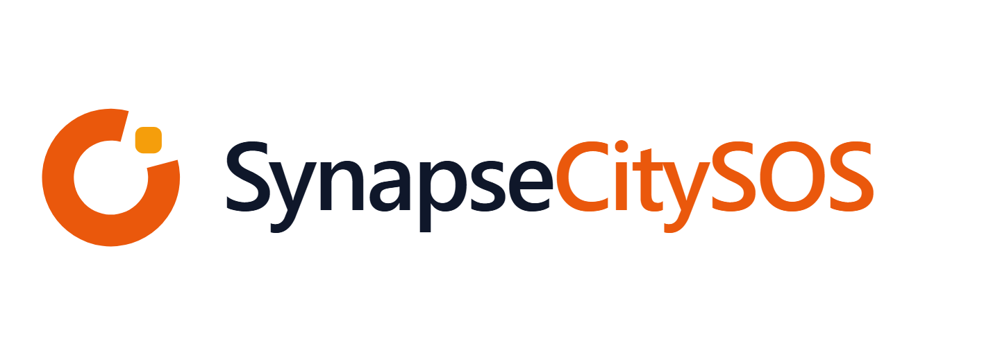
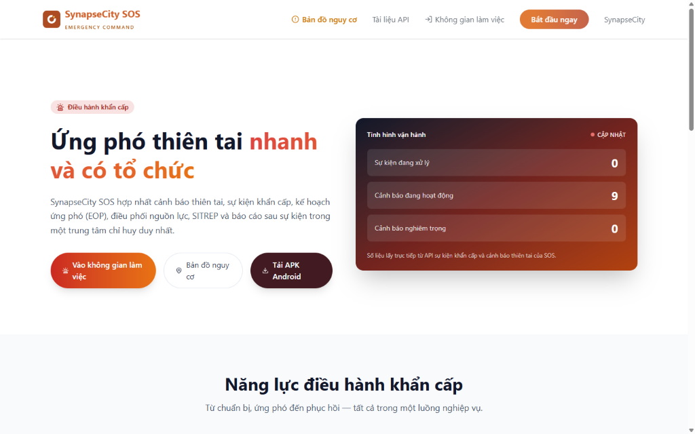
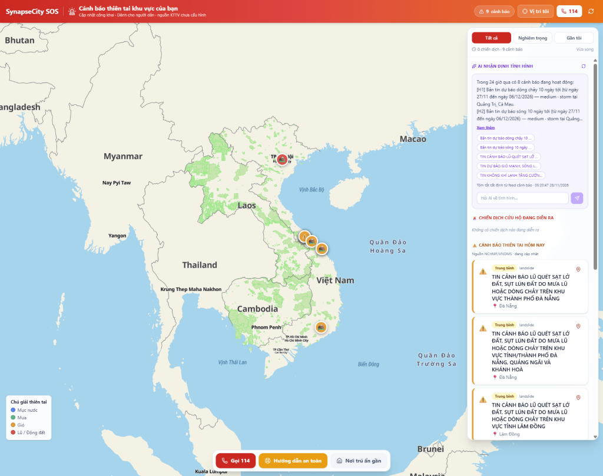

<p align="center">
  <picture>
    <source media="(prefers-color-scheme: dark)" srcset="apps/console/public/brand/logo-lockup-dark.png">
    
  </picture>
</p>

<h3 align="center">Open-source Tier-3 emergency command, live hazard monitoring, and disaster response</h3>

<p align="center">
  <a href="https://github.com/vku-open-source-2026/SynapseCitySOS/actions/workflows/ci.yml"></a>
  <a href="https://github.com/vku-open-source-2026/SynapseCitySOS/actions/workflows/release.yml"></a>
  <a href="LICENSE"></a>
</p>

<p align="center">
  <a href="https://sos.synapsecity.sbs">Live Portal</a> ·
  <a href="https://sos.synapsecity.sbs/map">Live Hazard Map</a> ·
  <a href="https://sos.synapsecity.sbs/docs">API Docs</a> ·
  <a href="https://synapsedx.sbs/workspace">Command Workspace</a> ·
  <a href="https://synapsecity.sbs">Sibling App: SynapseCity</a>
</p>

---

**SynapseCitySOS** is the emergency preparedness, response, and recovery product (Tier 3) of the Synapse platform. It unifies multi-source hazard feeds (including VNDMS ingestion), live SSE hazard streaming, AI-assisted Emergency Operations Plans (EOP), responder & shelter dispatch, immutable Situation Reports (SITREPs), and After-Action Reviews (AAR) atop **SynapseDX** (`@synapsedx/capabilities`).

## Preview

| Emergency Command Portal (`sos.synapsecity.sbs`) | Live Hazard Map & AI Brief (`sos.synapsecity.sbs/map`) |
| :---: | :---: |
|  |  |

## Key Features

- **Live Hazard Feeds & Spatial Search** — Flood, storm, landslide, and VNDMS feeds with radius (`near`) and GeoJSON polygon (`within`) queries.
- **Real-Time SSE Hazard Stream** — Shared Tier-2 event subscription streaming sanitized hazard snapshots and degraded-feed warnings without silent empty states.
- **AI-Grounded EOP Orchestration** — Versioned Emergency Operations Plan drafts generated via Tier-2 AI (with deterministic doctrine fallback) that compile directly into dispatch orders.
- **Responder & Shelter Dispatch** — Availability-aware unit optimizer across rescue teams, vehicles, medical supplies, equipment, and public shelters.
- **Immutable SITREPs & Automated AAR KPIs** — Delta-revisioned situation reports and weighted response/dispatch/SITREP/resource after-action scoring.
- **Native Android App & 4×3 SOS Widget** — GPS hazard radar, shelter finder, foreground SSE alerts, and home-screen emergency widget (`mobile/`).

## Architecture

```text
Browser / Android App
   │
   ▼
apps/gateway (:8086 host -> :8080 container, Rust/Axum)
   ├──► apps/sos-service (:8084, emergency operations backend)
   └──► apps/console (React public hazard map, safety guidance & API docs)
   │
   ▼  HTTPS / SSE (@synapsedx/capabilities)
SynapseDX (Tier 2) ──► SynapseOne (Tier 1)
```

> **Product Boundary:** SynapseCitySOS owns disaster and emergency operations only. Day-to-day municipal assets, IoT sensors, citizen infrastructure reports, and maintenance belong to its sibling product, [SynapseCity](https://github.com/vku-open-source-2026/SynapseCity). See [PRODUCT_BOUNDARY.md](PRODUCT_BOUNDARY.md).

## Quickstart

### 1. Query Live Hazard & Emergency Feeds (Zero Setup)

Public hazard layers, shelter lookups, and live SSE streams require no API key:

```bash
# Check active emergency operational summary
curl -s "https://sos.synapsecity.sbs/v1/emergency/public/status"

# Fetch active hazards from the last 24 hours
curl -s "https://sos.synapsecity.sbs/v1/hazards/recent?hours=24"

# Subscribe to the real-time SSE hazard stream
curl -N "https://sos.synapsecity.sbs/v1/emergency/stream/hazards"
```

### 2. Self-Host with Docker Compose (Recommended)

Requires **Docker Engine 24+** and **Docker Compose v2.24+**:

```bash
git clone https://github.com/vku-open-source-2026/SynapseCitySOS.git
cd SynapseCitySOS
cp .env.example .env                     # configure SYNAPSEDX_BASE_URL, SYNAPSEDX_API_KEY, AUTH_SECRET
export SYNAPSECITYSOS_VERSION=v0.2.2     # or latest

docker compose pull
docker compose up -d --no-build
curl http://127.0.0.1:8086/health
```

### 3. Run Locally from Source

Requires **Node.js 20+**, **Rust 1.82+**, and **Docker Compose v2.24+**:

```bash
npm ci
npm run build

# Start the SOS backend against the public Tier-2 demo
SYNAPSEDX_BASE_URL=https://synapsedx.sbs npm run start:service:legacy

# In a second terminal, run the public hazard map console
npm run dev --workspace=@synapsecity/sos-console
```

## Usage

### Key API Endpoints

| Method & Path | Auth | Description |
| :--- | :--- | :--- |
| `GET /v1/emergency/public/status` | Public | Active emergency events and alert counters. |
| `GET /v1/hazards/recent?hours=24` | Public | Recent non-expired flood, storm, and landslide observations. |
| `GET /v1/emergency/resources/shelters/near` | Public | Nearby emergency shelters (`lat`, `lng`, `radius_m`) with capacity status. |
| `GET /v1/emergency/stream/hazards` | Public | Unbuffered Server-Sent Events stream of active hazard snapshots. |
| `POST /v1/auth/exchange` | Tier-2 Bearer | Exchange a verified SynapseDX user token for a short-lived SOS session. |
| `* /v1/emergency/{eop,dispatch,sitrep,after-action}` | SOS Bearer | Command-center workflows operated via the SynapseDX Workspace. |

Find nearby emergency shelters via cURL:

```bash
curl -s "https://sos.synapsecity.sbs/v1/emergency/resources/shelters/near?lat=16.0544&lng=108.2022&radius_m=10000"
```

### Demo Seed & Workspace Plugins

Seed or reset the 15-minute emergency response scenario ([docs/DEMO_PACK.md](docs/DEMO_PACK.md)):

```bash
SOS_DEMO_TOKEN=<token> npm run demo:seed
SOS_DEMO_TOKEN=<token> npm run demo:reset
npm run plugins:check   # validate SynapseDX command workspace plugin bundles
```

### Android Client & Home-Screen Widget

- **Signed APK:** <https://synapsedx.sbs/v1/capabilities/public/files/synapsecity-sos-android-0.1.2-arm64-x86_64/content>
- **GitHub Release:** [`mobile-v0.1.2`](https://github.com/vku-open-source-2026/SynapseCitySOS/releases/tag/mobile-v0.1.2) (`SHA-256: f8c6621ad94b2edc8ccdac0352d7d592458d4c6aa848722fe4362c76c7bcd584`)

Build and verify from source ([mobile/README.md](mobile/README.md)):

```bash
cd mobile
npm ci
npm run verify
npm run build:android
```

## Testing & Contributing

```bash
npm test
npm run test:public-only
(cd apps/gateway && cargo test)
```

See [CONTRIBUTING.md](CONTRIBUTING.md), [PRODUCT_BOUNDARY.md](PRODUCT_BOUNDARY.md), and [CHANGELOG.md](CHANGELOG.md) for contribution guidelines and release history.

## License

Licensed under the [Apache License 2.0](LICENSE). See [NOTICE](NOTICE) and [THIRD-PARTY.md](THIRD-PARTY.md) for third-party attributions.
